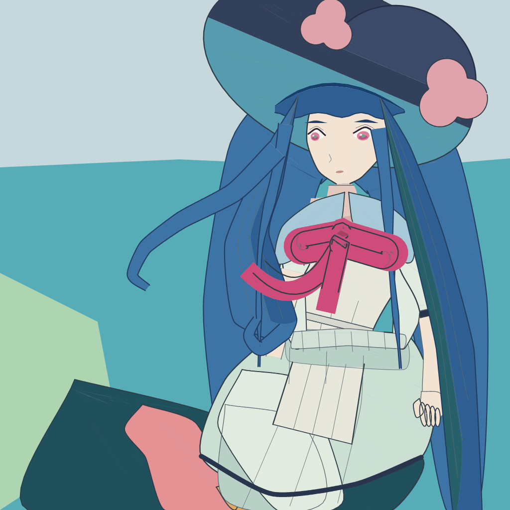

# A-full-figure-v2 — the whole figure, drawn

**Base.** This package is `A-full-figure-v1`'s source and tests copied byte-for-byte
(`evidence/A-full-figure-v1/`, commit `bfba8e7`, `artwork.svg` sha256 `b3ca14fd…`). v1 stays frozen with
its own review record; this package is the advance, and its evidence is rebuilt from its own bytes
(`P39`).

**Why it exists.** v1 is structurally whole — 31 objects, 57 parts, every one declared, every visible
cut computed by the depth engine — and its own accept line T1–T3/T5/T7 passes. Two independent sighted
reviewers then put the picture at **A3 / B3–4 / C2–3 / D0–3 / E4–5 / F1–3**, with D and F contested
(`evidence/reviews-r1c/`), and agreed on five things the self-review had missed:

1. **It does not read as seated** — the dark lower mass sits detached at the left of a symmetrical
   dress bell; there is no lap plane and no contact.
2. **The hand is a mitten** at ~(845, 820) — no fingers, no wrist, a blob at its top.
3. **The viewer-left shoulder/arm does not read as attached**; bow, sleeve, hair and torso collide at
   ~(585, 500).
4. **The background composition is deleted** — the mint wave, teal field and floating ribbons are flat
   angular blocks.
5. **The face is frontal and wide-eyed** where the reference is shy and downcast; the eyes are flat
   discs without lash weight or lid.

**The advance, in order** (`docs/0_ROADMAP.md`, W1–W2): stroke the shapes the figure already owns
(`P13`) and re-cut the face, the hand and the left arm; then the seated lower mass, the field and the
hair's volume. Every shape stays a generator with about four landmarks; the reference seeded the
numbers and is closed; depth decides visibility.

## W1 — contour, face, hand and far arm



- **Stage 1 — contour:** existing owned boundaries now carry a declared line class with a distinct
  weight hierarchy: silhouette over free edge, then closure/contact/fold; material trim, hair, hat and
  lash weights remain deliberately stronger where the drawing calls for them. Adjacent fills remain
  fills with separately depth-clipped edge marks.
- **Stage 2 — face:** each eye is a shallow sclera with a smaller off-centre iris, lower iris shade,
  pupil and catchlight under a heavy upper lash and a lighter lid crease. The lowered, off-centre gaze
  replaces the frontal full-height discs while preserving the head's near/far eye sizes.
- **Stage 3 — hand and far arm:** the visible hand is now a wrist/palm, a separate thumb and four
  separately outlined generated finger capsules. The other arm leaves the viewer-left cuff and runs
  behind the skirt; its hand remains hidden rather than invented.

**Rebuild and verify** (from the repository root):

```
PKG=.scratch/35-r1-articulated-study/evidence/A-full-figure-v2
.venv/bin/python $PKG/source/build_full.py --out $PKG/artwork.svg --report $PKG/build-report.json
.venv/bin/python scripts/draw.py check $PKG/artwork.svg --outdir $PWD/$PKG/check
.venv/bin/python $PKG/source/manifest_full.py --check
PYTHONDONTWRITEBYTECODE=1 .venv/bin/python -m unittest discover -s $PKG/tests -t $PKG
```

The image a reviewer judges is `check/draft-fullres.png`; `check/draft.png` is the same picture at
thumbnail scale and is not the one to judge. The build takes ~3 min on a loaded host; the suite is the
figure's own nine tests.

**Discipline.** No image read in `source/`; one line policy per mark class; every part declared in
`source/full/figure.py:OBJECTS`; deterministic rebuild; the manifest covers every file a rebuild needs.

**Base verified before the first edit.** Building this copy with the command above, unchanged, gives
`artwork.svg` sha256 `b3ca14fddb5d693ab705812de29df400418d3dde51d9e5e1d6e56306208984bc` — the same
bytes as v1's `artwork.svg`; 4,739 faces, 60 visible fill regions, 31 objects, no missing or undeclared
part.
