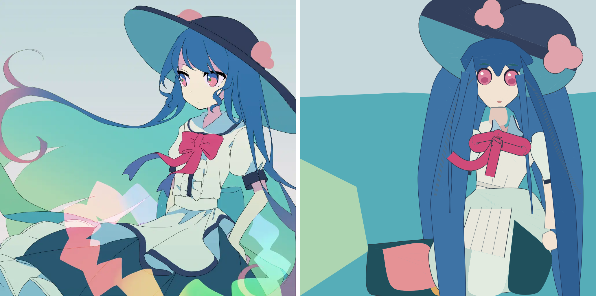

**English** | [简体中文](README.zh-CN.md)


# learn_draw

*Learning to draw as a computed skill — every picture built from declared parts, relations and depth, and judged one term at a time.*

**No diffusion, no pixel generation, no traced endpoint: the drawing itself is the deliverable, so each image is assembled from named components whose geometry is computed, whose visible cuts are decided by 3D depth, and whose quality is measured against a written acceptance line before a human ever looks at it.**



*The current advance: the reference `image.jpg` (left) beside `A-full-figure-v1` (right) — 25 named parts, every landmark a relation, every visible cut computed by the depth engine, the reference closed after it seeded the layout. Side-by-side produced by `scripts/draw check`.*

## Quick start

```bash
git clone --recurse-submodules https://github.com/ZisIsNotZis/learn_draw
cd learn_draw
uv venv .venv && uv pip install -e .      # numpy, opencv-python-headless, pillow, pyyaml
scripts/draw --help                       # the toolchain, no browser needed
```

Rendering SVG/HTML to PNG goes through a Chrome build: `scripts/renderer.py` takes the newest
`chromium_headless_shell-*` from the Playwright cache, or whatever `CHROME_HEADLESS_SHELL` points at.
Everything else — metrics, diffs, the ratchet — runs without it.

Rebuild the figure in the screenshot and its whole check bundle (~25 s):

```bash
PKG=.scratch/35-r1-articulated-study/evidence/A-full-figure-v1
.venv/bin/python $PKG/source/build_full.py --out $PKG/artwork.svg --report $PKG/build-report.json
scripts/draw check $PKG/artwork.svg --outdir $PWD/$PKG/check
```

## What it can do now

- **One command per judgement pass.** `scripts/draw check <art> --ref image.jpg` writes the whole
  bundle a reviewer needs: the 1:1 draft, a side-by-side, magnified REF|DRAFT crops of the worst
  regions with their coordinates, and `report.txt` with the metrics — no verdict, by design.
- **Metrics as an alarm, never a target.** Edge-F1, colour distance, coverage and edge-only diffs
  (`cyan` = missed line, `magenta` = invented line) are logged per iteration; a ratchet floor in
  `.scratch/00-tooling/baseline/` makes a regression visible instead of calling it progress.
- **Relations instead of coordinates.** `scripts/relate.py` resolves a YAML spec whose every position
  is expressed against the frame or another shape into absolute geometry, and materialises `region`
  nodes into frozen `traced` sidecars.
- **Depth decides what shows.** Components are 2D artwork plus a 3D support surface; the triangle
  depth engine clips the visible fragments. Nothing in a scene declares `visible_ranges` or paint
  order — that the hat is behind the hair and the falls in front of the sleeves is a depth result.
- **Generated ribbons.** One continuous two-sided strip on a computed support, with transverse camber,
  a bounded return bend, and per-material-side stripes — mesh, projection and visible fragments are
  all compiler output.
- **Articulated construction with a visibility oracle.** `scripts/articulated_construction.py` plus
  `scripts/vector_visibility.py` build a posed figure from joint/taper parameters and check the
  painted result against an exact reference visibility solver.
- **A whole figure, reference-free at build time.** `A-full-figure-v1` composes 25 parts into the
  reference's own 1024×1024 frame, reads no image, and binds its bytes with a manifest whose
  `--check` re-verifies them.

## Architecture

Three layers, one direction: authoring produces geometry, geometry produces an image, and the image is
judged by a harness that never edits it.

1. **Authoring — relations.** A spec names shapes and states where they sit in relation to the frame or
   to each other; `scripts/relate.py` resolves it. Vocabulary — ellipse, rotated dome, catmull route,
   tapered strip, polar clover, ribbon, eye — is finite, so a shape larger than a handful of landmarks
   has to come from a generator.
2. **Depth — components and supports.** A component is local 2D artwork (u, v) mapped onto a support
   surface in 3D; a camera projects it; overlapping triangles are depth-tested. The author declares
   attachment and coarse spatial relations, the engine derives every occlusion. `scripts/scene_render.py`
   compiles the resulting scene to SVG and through Chrome to PNG.
3. **Judgement — the check bundle and the ratchet.** The render is measured, diffed, cropped and logged;
   a fresh-context reviewer sees the images and nothing else. A picture that its own review rejects is
   never put in front of the person whose judgement it awaits.

```
docs/          the chain, one home per meaning: 0 roadmap · 1 problem · 2 goal · 3 requirement
               (P1–P41) · 4 usecase · 5 product · 6 architecture · 7 interface · 8 detail · 9 implementation
scripts/       the toolchain: draw.py (CLI) · relate.py · scene_render.py · renderer.py ·
               ribbon_family / ribbon_surface / ribbon_return / ribbon_drawing ·
               articulated_construction · vector_visibility · figure_scaffold ·
               spatial_sketch · similarity.py · tests/
.scratch/      the record area: NN-slug/ exercises with spec, work, evidence and log; the ratchet floor
inbox/ mail/   messages: what an upward report says, and this project's own mailbox
teaching/      reference-free method notes and the public role card
vendor/        third-party learning material, submodules, never edited
assets/        the logo
image.jpg,     the reference target and the component plates cropped from it (study material,
*.png          not covered by the code licence — see Licensing)
```

`AGENTS.md` is the entry point for an agent working here: the rules that override habit, and a table
that routes any question to the one document that owns it.

## How to develop

The environment is `pyproject.toml`'s: `uv venv .venv && uv pip install -e .`, Python ≥ 3.11. Scripts are
run through the `scripts/draw` wrapper, which prefers `.venv/bin/python`.

The three gates before a commit that touches code or a drawing (from `docs/9_IMPLEMENTATION.md`):

```bash
.venv/bin/python scripts/tests/test_scene.py                                    # smoke suite
scripts/draw check .scratch/00-tooling/baseline/best.png --ref image.jpg        # all deltas +0.000
# render the same spec twice and compare sha256                                   # determinism
```

The other suites in `scripts/tests/` are `unittest` modules and run on their own, e.g.
`.venv/bin/python scripts/tests/test_ribbon_family.py`; a drawing package carries its own suite next to
its build (`.scratch/…/tests/`), run with `python -m unittest discover`. `pyrightconfig.json` configures
Pyright for editors that read it.

## Contributing

This is a personal study with a strictly written method; read [`CONTRIBUTING.md`](CONTRIBUTING.md)
before opening anything. The short version: a change is justified by a statement about the drawing, not
by a metric moving.

## Roadmap

**Implemented**

- The measurement harness and the ratchet (`check`, `diff`, `compare`, `ref palette`, `measure`, `log`,
  `baseline`, `freeze`) and the headless renderer that every tool shares.
- The relational authoring layer and the scene compiler.
- The 2D exercise ladder — bust, torso, cloth, ribbon, fields, assembly — through the reference-closed
  and reference-free withdrawals, with their evidence under `.scratch/`.
- The ribbon engines: continuous strip on a computed support, camber, return bend, depth-visible ink.
- Articulated construction with an exact vector visibility oracle.
- `A-full-figure-v1`: the whole figure, reference closed, seven-term acceptance line met at round 28.

**Planned**

- The person's reading of the figure, then the craft list its own review kept — flat background fields,
  a crude arm, the bodice's severed waist edge, single-tone hair fills, no fringe strands.
- The two object studies (a bow, a reference-free hand holding a dish), built, twice failed on their
  images, and now parked at the person's direction rather than deleted.
- Integrated acceptance of the articulated study: reference-absent reproduction, and the sealed held-out
  brief read only when its release is authorised.
- Responsive components and pose variation; then a composed, reference-based illustration; then a
  bounded body of transfer work, ending in an original drawn from a short intent brief alone.

The direction is unchanged and it is not a benchmark: the skill is the deliverable, so each stage closes
its own reference — reproduce a given picture, then reproduce it with the reference gone, then draw a
new one from intent, up to a Starry-Night-class scene that no parameter was fitted to.

## Where the facts live

`docs/` is the project's memory and answers by question, not by date: `0_ROADMAP.md` (milestones, gates,
the current advance), `1_PROBLEM.md` (why), `2_GOAL.md` (what good means), `3_REQUIREMENT.md` (the
binding rules `P1`–`P41`), `4_USECASE.md` (the loop and the review protocol), `5_PRODUCT.md` (the
authoring language and the adopted canons), `6_ARCHITECTURE.md`, `7_INTERFACE.md`, `8_DETAIL.md`,
`9_IMPLEMENTATION.md` (commands, gates, environment). `.scratch/`, `inbox/`, `mail/` and `teaching/`
hold records: what was run, what came back, on which revision — they keep their dates and their dead
links, and they are never a second home for a fact.

## Licensing

The **code and documentation** in this repository are free software under the **GNU Affero General
Public License v3.0** — see [`LICENSE`](LICENSE).

**Third-party material is not covered by that grant.** This repository also contains reference and
target imagery used as study material:

- `image.jpg` — the drawing target (a third-party illustration);
- `head.png`, `head_hat.png`, `hat.png`, `ribbon.png`, `cloth.png`, `dress.png`, `cutout.png` —
  component plates cropped or redrawn from it;
- renders and comparisons under `.scratch/**/evidence/` that reproduce it.

Those files remain the property of their original rights holders and are included only as the
reference a study of this kind requires. The AGPL grant above applies to the project's own code, docs
and outputs, not to them. `vendor/` holds third-party learning material under its own licences.
