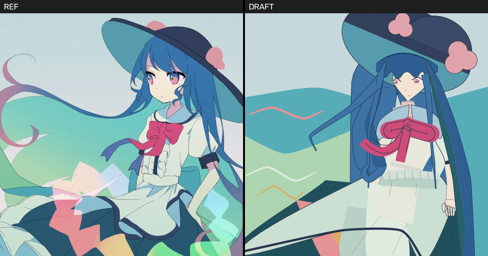

[English](README.md) | **简体中文**


# learn_draw

*把绘画当作一项可计算的手艺来学——每张图都由声明的部件、关系和深度构成，并按照事先写好的验收线逐条评判。*

**这里没有扩散模型，没有像素生成，也不把描图当作终点：交付物就是画本身，所以每张图都由具名部件拼成，几何由计算得出，可见的遮挡边界由三维深度决定；质量在交到等待评判的人眼前之前，先由独立的、能看图的评审按一份写好的六轴量规逐项判读。**



*当前推进：参考图 `image.jpg`（左）与 `A-full-figure-v2`（右）并列——31 个对象、57 个部件，每个定位点都来自关系，每条可见边界都由深度引擎算出，参考图在为布局播种之后即被封闭。并列图由 `scripts/draw check` 生成。图是完整的，也还没画完：它自己的独立评审给出 A3 / B4 / C3 / D1–3 / E4–5 / F3–4，尚未达到里程碑的门槛；剩下的缺陷由人来排序。*

## 快速开始

```bash
git clone --recurse-submodules https://github.com/ZisIsNotZis/learn_draw
cd learn_draw
uv venv .venv && uv pip install -e .      # numpy、opencv-python-headless、pillow、pyyaml
scripts/draw --help                       # 整个工具链，不需要浏览器
```

把 SVG/HTML 渲染成 PNG 需要一份 Chrome 构建：`scripts/renderer.py` 会取 Playwright 缓存里最新的
`chromium_headless_shell-*`，或用 `CHROME_HEADLESS_SHELL` 指定的那一份。其余部分——度量、差分、棘轮——
不需要它。

重建截图里那张图及其全部检查包（约几分钟：深度引擎要对约 4.7k 个三角面两两求解）：

```bash
PKG=.scratch/35-r1-articulated-study/evidence/A-full-figure-v2
.venv/bin/python $PKG/source/build_full.py --out $PKG/artwork.svg --report $PKG/build-report.json
scripts/draw check $PKG/artwork.svg --outdir $PWD/$PKG/check
```

## 现在能做什么

- **一轮评判只消一条命令。** `scripts/draw check <art> --ref image.jpg` 一次写出一名评审所需的全部材料：
  1:1 原尺寸草图、并列图、误差最大区域的 REF|DRAFT 放大裁片（带坐标），以及含度量数字的 `report.txt`——
  按设计不给结论。
- **度量是警报，不是目标。** 边缘 F1、颜色距离、覆盖率与纯边缘差分（`cyan` 为漏画的线，`magenta` 为多画的线）
  逐轮记入日志；`.scratch/00-tooling/baseline/` 里的棘轮底线让回退看得见，而不是被当成进步。
- **写关系，不写坐标。** `scripts/relate.py` 把 YAML 规格（每个位置都相对于画框或另一个形状表达）解析成绝对几何，
  并把 `region` 节点固化成 `traced` 边车文件。
- **显示什么由深度决定。** 部件是二维画稿加一块三维支承面；三角面深度测试裁出可见片段。场景里没有任何一处声明
  `visible_ranges` 或绘制顺序——帽子在头发之后、发绺在袖子之前，都是深度算出来的结果。
- **生成的缎带。** 一条连续的双面缎带铺在计算出的支承面上，带横向拱度、有界的回折弯，以及按材质面分色的条纹——
  网格、投影和可见片段全部是编译产物。
- **带可见性裁决器的关节构造。** `scripts/articulated_construction.py` 配合 `scripts/vector_visibility.py`，
  由关节与锥度参数搭出姿态，再用精确的矢量可见性求解器校验画出来的结果。
- **一张完整的全身像，构建时不看参考。** `A-full-figure-v2` 把 31 个对象中的 57 个部件合成进参考图自己的 1024×1024 画框，
  不读任何图像，并用清单把字节绑定起来，`--check` 可随时复核。

## 架构

三层，方向单一：作画产出几何，几何产出图像，图像则由一套从不修改它的工具来评判。

1. **作画——关系。** 规格给形状命名，并说明它相对于画框或彼此的位置；`scripts/relate.py` 负责解析。词汇表
   （椭圆、旋转穹顶、catmull 路径、渐变带、极坐标三叶形、缎带、眼睛）是有限的，因此超过寥寥几个定位点的形状
   必须由生成器给出。
2. **深度——部件与支承面。** 部件是局部二维画稿 (u, v) 映射到三维支承面上；相机把它投到画布；重叠三角面做深度测试。
   作者只声明附着和粗略的空间关系，所有遮挡由引擎推出。`scripts/scene_render.py` 把得到的场景编译成 SVG，
   再经 Chrome 变成 PNG。
3. **评判——检查包与棘轮。** 渲染结果被度量、差分、裁片并记入日志；一位全新上下文的评审只看图，不看别的东西。
   被自身评审否决的图，绝不会出现在等待评判的人面前。

```
docs/          文档链，一个含义一个家：0 路线图 · 1 问题 · 2 目标 · 3 硬性规则（P1–P41）· 4 使用场景 ·
               5 产品 · 6 架构 · 7 接口 · 8 细节 · 9 实施
scripts/       工具链：draw.py（命令行）· relate.py · scene_render.py · renderer.py ·
               ribbon_family / ribbon_surface / ribbon_return / ribbon_drawing ·
               articulated_construction · vector_visibility · figure_scaffold ·
               spatial_sketch · similarity.py · tests/
.scratch/      记录区：NN-slug/ 练习目录（spec、work、evidence、log）与棘轮底线
inbox/ mail/   消息：向上级报告的内容，以及本项目自己的信箱
teaching/      无参考方法的笔记与公开角色卡
vendor/        第三方学习材料，submodule，从不改动
assets/        图标
image.jpg,     参考目标图与从它裁出的部件图版（研究材料，不在代码授权范围内——见“许可”）
*.png
```

`AGENTS.md` 是给在这里工作的 agent 的入口：那些优先于习惯的规则，以及一张把任何问题路由到唯一归属文档的表格。

## 如何开发

环境由 `pyproject.toml` 声明：`uv venv .venv && uv pip install -e .`，Python ≥ 3.11。脚本通过 `scripts/draw`
包装器运行，它优先使用 `.venv/bin/python`。

改动代码或画作时的三道提交前关卡（出自 `docs/9_IMPLEMENTATION.md`）：

```bash
.venv/bin/python scripts/tests/test_scene.py                                    # 冒烟测试
scripts/draw check .scratch/00-tooling/baseline/best.png --ref image.jpg        # 所有差值 +0.000
# 同一份规格渲染两次并比较 sha256                                                # 确定性
```

`scripts/tests/` 里其余套件是 `unittest` 模块，可单独运行，例如 `.venv/bin/python
scripts/tests/test_ribbon_family.py`；每个画作包把自己的一套测试放在构建脚本旁边（`.scratch/…/tests/`），
用 `python -m unittest discover` 运行。`pyrightconfig.json` 为读取它的编辑器配置 Pyright。

## 参与

这是一个方法写得极死的个人研究项目；动手之前请读 [`CONTRIBUTING.md`](CONTRIBUTING.md)。一句话版本：
改动的理由必须是一句关于这张画的话，而不是某个指标动了。

## 路线图

**已完成**

- 度量工具箱与棘轮（`check`、`diff`、`compare`、`ref palette`、`measure`、`log`、`baseline`、`freeze`），
  以及所有工具共用的无头渲染器。
- 关系化作画层与场景编译器。
- 二维练习阶梯——胸像、躯干、衣料、缎带、柔场、组合——直到封闭参考与完全无参考的抽身练习，
  证据都在 `.scratch/` 下。
- 缎带引擎：计算支承面上的连续带、横向拱度、回折弯、随深度可见的墨线。
- 关节构造，以及精确的矢量可见性裁决器。
- `A-full-figure-v2`：整幅全身像，参考已封闭，由 57 个声明部件确定性地构建；它自己的独立评审给出
  A3 / B4 / C3 / D1–3 / E4–5 / F3–4，图正在等待人的判读。

**计划中**

- 人对这张全身像的判读——哪个缺陷最要紧由他决定；然后是那个缺陷的修复，评审对点出的五处
  （坐姿与裙摆、脸、蝴蝶结、头发、左侧背景的浪）已经摆在桌上。
- 两个物件研究（一只蝴蝶结、一只无参考的手托着盘子），各建过、各在自己的图上失败两次，现按人的指示封存，
  而不是删除。
- 关节研究的完整验收：无参考复现，以及只在获准解封时才读取的密封留出任务书。
- 部件响应与姿态变化；然后是参考驱动的完整构图的插画；然后是一组有界的迁移作品，
  终点是只凭一段简短意图写出的原创画。

方向没变，而且它不是基准测试：交付物是手艺本身，所以每个阶段都自己收口——复现一张给定的画，
再在参考消失后复现它，再凭意图画出新的一张，直到一幅没有任何参数被拟合过的、星月夜级别的场景。

## 事实住在哪里

`docs/` 是这个项目的记忆，按问题而不是按日期作答：`0_ROADMAP.md`（里程碑、关卡、当前推进）、
`1_PROBLEM.md`（为什么）、`2_GOAL.md`（什么叫好）、`3_REQUIREMENT.md`（硬性规则 `P1`–`P41`）、
`4_USECASE.md`（循环与评审规程）、`5_PRODUCT.md`（作画语言与采纳的规范）、`6_ARCHITECTURE.md`、
`7_INTERFACE.md`、`8_DETAIL.md`、`9_IMPLEMENTATION.md`（命令、关卡、环境）。`.scratch/`、`inbox/`、
`mail/` 与 `teaching/` 存放记录：跑过什么、回来什么、绑在哪一版——它们保留自己的日期和失效链接，
并且永远不是某个事实的第二个家。

## 许可

本仓库的**代码与文档**是自由软件，采用 **GNU Affero 通用公共许可证第 3 版**——见 [`LICENSE`](LICENSE)。

**第三方材料不在该授权范围内。** 本仓库还包含作为研究材料使用的参考图与目标图：

- `image.jpg` —— 绘画目标（一张第三方插画）；
- `head.png`、`head_hat.png`、`hat.png`、`ribbon.png`、`cloth.png`、`dress.png`、`cutout.png` ——
  由它裁出或重绘的部件图版；
- `.scratch/**/evidence/` 下复现它的渲染结果与对比图。

这些文件仍归其原始权利人所有，收录进来仅因为这类研究需要一张参考。上述 AGPL 授权适用于本项目自己的代码、
文档与产出，不适用于它们。`vendor/` 存放第三方学习材料，遵循各自的许可。
