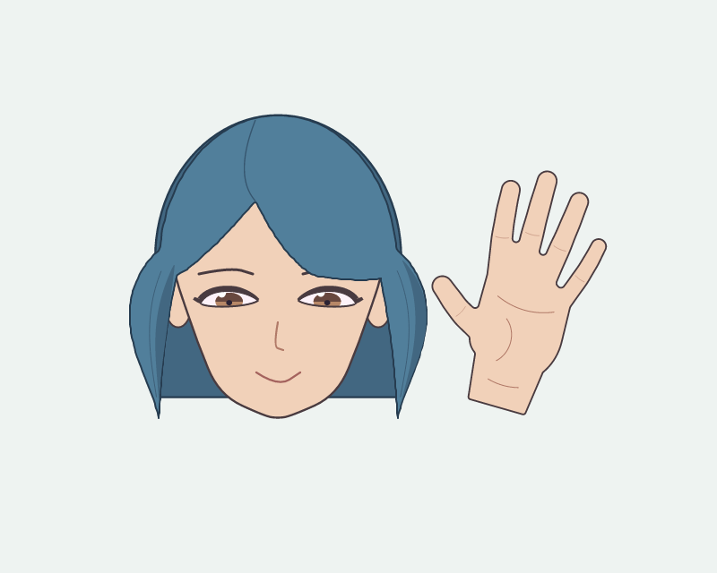

# Open-hand primitive and independent creation

## Result and boundaries

A pure CPU/vector front-view open hand is now available through new/add/inspect/preview/accept/undo.
It has five distinct digits, adjustable spread and handedness, coherent colours and visible
knuckle/tip selection. Screen-direction tip motion changes one finger about a protected knuckle;
invalid collisions are refused. It is a flat icon tool, not a complete anatomical or 3D hand rig.

The independent creator read only the skill/public CLI, made the scene and all accepted revisions
without JSON/SVG/source edits, and discarded a finger tweak that did not improve its picture.
[Its complete command and usability record](usability/REVIEW.md) preserves that judgement.
The image is separate head and hand stickers, not a connected waving body.
[Fresh-context review A](fresh-review-a.md) and [B](fresh-review-b.md) independently assess the actual
images. The earlier final-review-a/b files are repeat observations by the encoding-study reviewers,
not fresh-context evidence. The reviews see five fingers and retain
hard thumb/wrist transition, flat volume and rigid hair as limitations. They are critiques, not
human acceptance or a whole-artwork pass. No baseline was promoted.

## Comparable construction studies

- 01-existing: source and actual legacy hand outputs, including four-finger configuration and axis
  correction. Placements follow (cos tilt,sin tilt), while the ellipse's long ry axis follows
  tilt+90 degrees. Correcting orientation connects parts but still produces a radial petal fan.
  Four-digit cartoon convention itself is not the identified defect. Legacy source was not changed.
- 02-knuckle-capsules: independent knuckles, bone ratios, opposing thumb and short wrist establish
  a recognizable five-digit open palm. Root/wrist transitions remain hard.
- 03-soft-webs: width modulation creates beaded fingers; rejected.
- 04-smooth-skin: adopted basis. Continuous Hermite centerline and width field remove the beads.
- 05-thumb-web and 06-junction-fillet: attempted web/fillet mechanisms had little useful visible
  effect; preserved as experiments, omitted from the production interface.
- 07-integrated and 08-index-tip: initial integration snapshots, before subsequent source changes;
  their implementation hashes are historical and their selections must not be reused as current.
- usability: fresh creator's complete actual scene, CLI trials, discarded proposal and final asset.
- verification: current repeated builds and exact hashes. examples/studio/hand.json is the default;
  examples/studio/greeting.json copies the independent final scene without root art repair.

## Verification and corrections

71 focused/inherited operation, checker and depth tests pass; 81 CPU smoke checks pass. The default
hand and independent greeting repeat identical SVG and CPU resvg PNG bytes. The accepted default
head PNG remains 23ad96c4ac624d9dd75b3187d0e56bdb0da4635d774727c4c7022bdbdb8bc48a.
verification/validation.json binds the implementation and individual scenes to their hashes.
Compilation is also tested from a fresh directory with image/browser access forbidden. These checks
establish operation properties; visual quality comes from the actual pictures and reviews.

A shared hand outline is quantized to 0.0001 palm units. Unselected digit centerlines, handles and
knuckles are exact invariants; re-tessellation of the common union can cause subpixel contour and
antialias changes elsewhere. An initially overstrict exact-pixel test was corrected to the stated
geometric resolution after diagnosis. Grid normalization did not fix that antialias difference;
no pixel-specific correction was applied. Real disconnected polygons and holes are refused.

A failed new preview request in a reused output directory initially left an old ready candidate.
The regression failed before the fix. Preview now invalidates the previous candidate/report before
computing a new edit, so an invalid request cannot accidentally accept the old proposal.

## Inspection anomaly: observation versus file contents

The independent creator once saw a blank normal view while closeups were visible. Do not read that
as saved renderer corruption. The original SVG/PNG for smile/final/reinspection are byte-identical;
Pillow decoding finds the original and both old review-pack fullres files exactly pixel-identical
in RGBA (800x640, 751 colours, opaque complete artwork). Native original PNG SHA256 is
d88368fef8f18b41345c01564d0655130a51c84ce578c967cc1f460c06defa92.

inspection-encoding retains the diagnostic script, anonymous A-D cases, mapping and facts. Two
independent viewers saw A/D complete and B/C blank, while another observation saw C complete/D blank.
Thus neither RGB/RGBA nor compression/chunk layout is established as the cause. The viewing/delivery
inconsistency remains unexplained. The original usability report keeps its observation and appends
the file-verification correction. There was no basis for changing the drawing or blaming a model.

draw check now preserves input PNG bytes in the full-resolution image and reports their digest;
JPEG and other inputs are properly converted. Two focused tests cover both paths and self-checking.
Both final reviewers see the source-preserved fullres picture. This is a narrower, traceable review
path, not proof of a universal external-viewer fix. No arbitrary re-encoding/re-render retries added.

Final source formatting removes one extra blank line at EOF from hand.py after the independent
exercise. verification/hand-before-eof-cleanup.py preserves that actor source; this changes the
implementation fingerprint without changing geometry. Current rebuilds still match its artwork.
